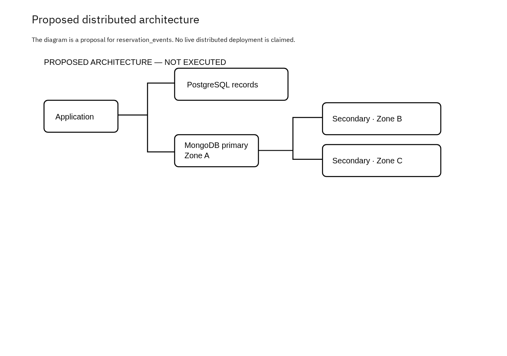

# Hotel Reservation System — Portfolio 5

This is the proposed distributed design for the case study.

## Case and proposed deployment

Hotel Reservation System keeps its relational records in PostgreSQL. MongoDB stores reservation_events: Store append-only reservation event documents with event metadata and guest and room snapshots, preserving context when source details later change. Proposed deployment: the application connects to a three-member MongoDB replica set across three availability zones in one region. PostgreSQL also needs its own managed high-availability configuration. These are separate databases; a MongoDB replica set does not replicate PostgreSQL.

## Replication and availability

One primary accepts writes. Two secondaries copy the oplog asynchronously. If the primary fails, eligible members can elect a replacement when a voting majority is available. Writes can pause during election. A partition without a majority cannot elect a primary. Three containers on one computer would not protect against loss of that computer.

## Consistency and the case

For reservation_events, a proposed client policy is majority write concern with a finite timeout, primary reads and majority read concern where committed data is required. Secondary reads can lag. Application retries need an idempotency key so the same event is not recorded twice. PostgreSQL constraints remain authoritative for A hotel's star rating must be between one and five inclusive. These settings do not create an atomic transaction across PostgreSQL and MongoDB. An outbox and retrying consumer would be a separate implementation.

## Sharding trade-off

Sharding partitions documents; replication copies them for availability. The small sample in this portfolio does not need sharding. If reservation_events becomes large, evaluate a high-cardinality source-record identifier as a possible hashed shard key against actual query and write patterns. A time-only increasing key can concentrate new writes, while a hashed key can make time-range queries contact multiple shards. Validate distribution and query plans before choosing a key.

## Cloud deployment and recovery

A real deployment would use private networking, authentication, least-privilege roles, TLS, monitoring and tested backups. Replication also copies accidental deletions, so it does not replace backups. Availability zones do not provide regional disaster recovery. No cloud service was provisioned and no failover, replication, sharding or recovery experiment was run for this discussion.

## References

- [MongoDB: replication](https://www.mongodb.com/docs/manual/replication/)
- [MongoDB: sharding](https://www.mongodb.com/docs/manual/sharding/)

